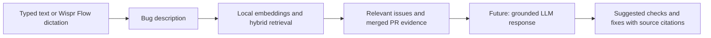

# Fixfinder

**Version 0.1.0 — first working MVP**

A local Streamlit application for bug triage. Describe a new Streamlit bug to find historical reports, compare evidence, and inspect the merged pull requests that resolved them.


The interface uses an original dark and purple visual design inspired by the supplied reference, with a Fixfinder wordmark, direct GitHub links, example prompts, component filtering, and exportable results. Each result shows shared terms, an excerpt from the report, the prior fix, and tabs for inspecting the full report and PR. Results remain available when interacting with the page; selecting an example fills the editor and leaves existing results labeled with their original query until a new search is submitted.

## Run locally

Prerequisites: Git, Python 3.11 or 3.12, and internet access for dependency installation and the first embedding-model download. No paid model API key is required.

Clone the project and optionally select this first-version snapshot:

```sh
git clone https://github.com/bhavya1006/fixfinder.git
cd fixfinder
git checkout v0.1.0
```

Omit the checkout command to use the latest `main` branch. For development from the snapshot, create a new branch with `git switch -c your-feature-name`.

On Windows (PowerShell):

```powershell
python -m venv .venv
.venv\Scripts\Activate.ps1
python -m pip install -r requirements.txt
python -m streamlit run app.py
```

On macOS/Linux:

```sh
python3 -m venv .venv
source .venv/bin/activate
python -m pip install -r requirements.txt
python -m streamlit run app.py
```

Open the localhost URL printed by Streamlit (normally `http://localhost:8501`). No external database service is required. The first search downloads the public MiniLM model if `data/models/` is absent; subsequent searches run locally. The supplied SQLite database already contains the dataset embeddings. If the dataset changes, the app automatically rebuilds the index. To download the model and rebuild embeddings before opening the interface, run `python fixfinder.py`.

If PowerShell blocks activation, use `.venv\Scripts\python.exe -m pip install -r requirements.txt` and `.venv\Scripts\python.exe -m streamlit run app.py` directly. Stop the server with Ctrl+C. Restart it after changing backend Python modules if an existing session still uses old code.

## Using Fixfinder

1. Type or dictate a description into **What’s breaking?** Include the affected widget, observed symptom, expected behavior, and reproduction trigger.
2. Optionally narrow the search to a Streamlit component, then select **Find similar bugs**. Example buttons fill the editor so you can try a known symptom.
3. Review up to three results. Each shows semantic similarity, shared terms, a report excerpt, and the previous fix.
4. Open **Compare report & inspect the fix** to read the original report, PR details, and comparison prompts. Follow the GitHub issue and merged PR links to inspect the source evidence.
5. Export your results as JSON, or clear the search and try another description.

Try: “In st.data_editor, entering .5 drops the decimal point and saves 5 instead.” A relevant historical case is [issue #16909](https://github.com/streamlit/streamlit/issues/16909), resolved by [PR #16920](https://github.com/streamlit/streamlit/pull/16920).

## Voice-to-text: Wispr Flow only

The documented voice-input workflow uses **[Wispr Flow](https://wisprflow.ai/)** solely to turn speech into text. Install and configure Wispr Flow separately, focus Fixfinder’s bug-description field, and use your configured Flow dictation shortcut. Review the resulting text, correct technical names or error messages if needed, and select **Find similar bugs**. You can also dictate elsewhere and paste the text into the field.

Wispr Flow is the only voice-to-text tool used in this workflow. Fixfinder itself has no microphone recorder, speech model, Wispr SDK/API integration, or audio upload endpoint. Typing and pasting work without Wispr Flow installed. Wispr Flow does not retrieve issues, generate embeddings, or produce fixes; those responsibilities belong to Fixfinder’s retrieval pipeline.

Local processing applies to the text search inside Fixfinder. Wispr Flow is a separate application with its own processing and privacy terms; using it should not be interpreted as an entirely offline audio workflow. This repository has not tested end-to-end microphone dictation; the text-input and retrieval paths are tested.

## Dataset

`data/issues.json` contains 100 historical bugs from [streamlit/streamlit](https://github.com/streamlit/streamlit). Streamlit has structured reports, reproduction examples, explicit bug labels, and a substantial history of merged fixes. This dataset intentionally focuses on one project; it is useful for Streamlit bug triage, not arbitrary repositories.

Each record includes a stable ID, repository, issue number, title, cleaned description, labels, issue URL, state and closing date, resolution and evidence type, and a related PR object with title, URL, description, merge timestamp, and commit SHA. Resolution text reports the merged PR title; it does not invent a root cause or claim a particular released version contains the fix. Some fixes clarify documentation.

The collector requires a closed `type:bug` issue and a merged PR whose body explicitly says `Fixes #…`, `Closes #…`, or equivalent. It excludes short descriptions, duplicate labels, not-planned closures, identical bodies, and near-identical bodies. HTML comments and template checkboxes are removed. This is an automatically filtered convenience sample, not a manually adjudicated benchmark. Issue templates and environment details can still influence retrieval.

`data/provenance.json` records selection and quality rules. Original public issue and PR text belongs to its contributors; source links are retained for attribution. The repository's code license should not be assumed to license all user-submitted discussion text.

To refresh from GitHub:

```powershell
python scripts/collect_issues.py
python fixfinder.py
```

The collector caches raw responses in ignored `data/source_cache/`. Remove that directory before collecting fresh upstream data. Optionally set `GITHUB_TOKEN` for higher GitHub API rate limits; never commit it. Collection uses up to 40 paginated API requests and fails without replacing the dataset if fewer than 90 eligible cases are found.

## Simple architecture

`GitHub REST API → data/issues.json → MiniLM embeddings → SQLite → semantic + keyword ranking → Streamlit`

- `scripts/collect_issues.py`: reproducible collection and filtering.
- `fixfinder.py`: local model loading, embedding, persistent vector store, and retrieval.
- `app.py`: input form and historical result cards.
- `data/vectors.sqlite3`: normalized float32 embeddings, issue metadata, and dataset/model signature.
- `assets/style.css` and `.streamlit/config.toml`: interface styling and theme.
- `tests/test_fixfinder.py`: dataset, retrieval, and interaction checks.
- `VERSION` and `CHANGELOG.md`: first-version identifier and release notes.

The embedding model is [sentence-transformers/all-MiniLM-L6-v2](https://huggingface.co/sentence-transformers/all-MiniLM-L6-v2), with 384 dimensions. Long descriptions are split into token-sized chunks, encoded, averaged, and normalized. Queries use the same pipeline. Only issue descriptions are embedded; resolutions and PR bodies do not leak into retrieval. SQLite stores the vectors as BLOBs, and NumPy performs exact cosine search over all 100 rows. This deliberately avoids an approximate-nearest-neighbor service or database extension at this scale.

Ranking combines description cosine similarity (85%) with TF-IDF cosine similarity over titles and descriptions (15%, titles counted twice). The lexical signal downweights common template words and favors distinctive symptoms and component names. Optional component filtering limits results to exact GitHub feature labels. These weights are heuristics, not a trained duplicate classifier.

The displayed semantic cosine score uses its raw -1 to 1 scale, not a duplicate probability. Ranking-score details are available in the comparison tab. If all returned semantic scores are below 0.35, the app displays a weak-similarity message. It returns up to three candidates within the chosen component. Developers must compare symptoms, versions, and reproduction steps before applying a fix.

“Why this surfaced” is extractive evidence: literal shared terms and a relevant report excerpt. It does not claim to explain the neural model's internal reasoning. Query terms missing from a report are offered as comparison prompts, not verified differences. Resolution text and PR details remain sourced directly from GitHub; no AI-generated root causes or fixes are invented.

## Future RAG implementation

Version 0.1.0 implements **retrieval**, the foundation of retrieval-augmented generation (RAG). It does not yet call an LLM or generate a new solution. A future version could pass the retrieved evidence to a language model to explain likely causes and suggest grounded next steps.



A practical next iteration would:

1. Index separate symptom, reproduction, resolution, and PR-diff chunks while preserving issue IDs, URLs, version context, and merge dates.
2. Retrieve and rerank relevant chunks, then assemble a bounded context containing the user's bug and source evidence.
3. Ask a local or explicitly configured hosted LLM to distinguish observed evidence from hypotheses, cite the issue/PR supporting each suggestion, and say when the available reports are insufficient.
4. Treat retrieved issue text as untrusted data, not instructions. Keep source comparison visible and require developer review before applying any proposed code change.
5. Evaluate retrieval on labeled duplicate/nonduplicate reports and evaluate generated answers for citation correctness and supported claims before claiming better accuracy.

Wispr Flow would remain only the speech-to-text entry point. Adding RAG would introduce a separate generation component; a hosted model would also change where query text is processed. Multi-repository support, broader historical coverage, release-aware filtering, and calibrated relevance thresholds are further opportunities.

## Versioning and repository contents

`v0.1.0` marks the first working version, with the current UI, 100-case dataset, vector database, collector, and tests. See [CHANGELOG.md](CHANGELOG.md). Downloaded model weights, the virtual environment, raw collection caches, temporary test files, and local secrets are excluded from Git. Another user can regenerate the model cache and database using the commands above.

## Verify

```powershell
python fixfinder.py
python -m pytest -q
```

Tests check dataset quality, ranking, stale-index detection, evidence extraction, component filtering, real-model self-retrieval and symptom paraphrases, plus Streamlit submission, result persistence, example selection, and clear/validation behavior. They do not establish duplicate-detection precision or recall; that requires a separately labeled evaluation set.
